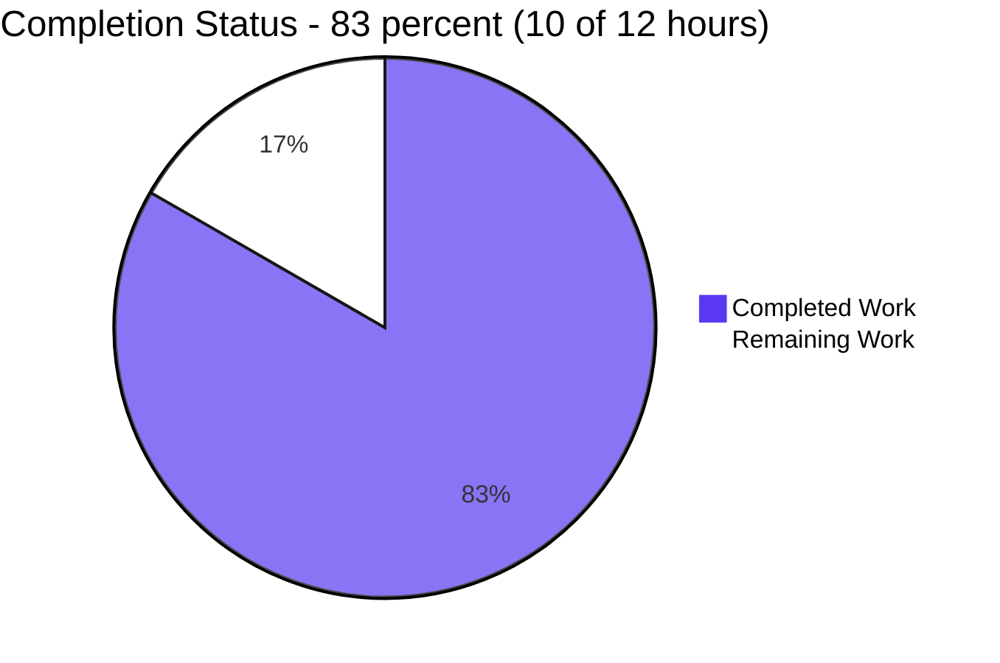
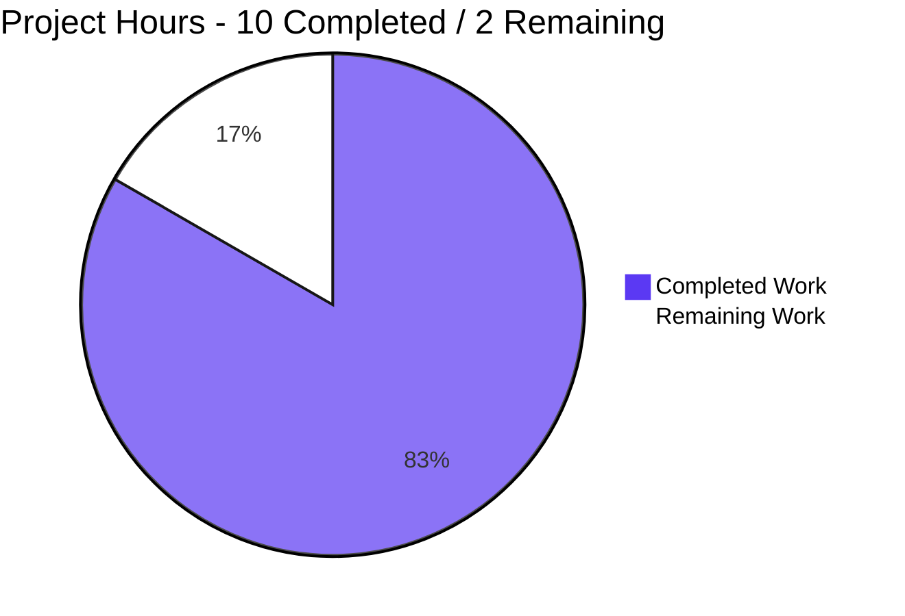
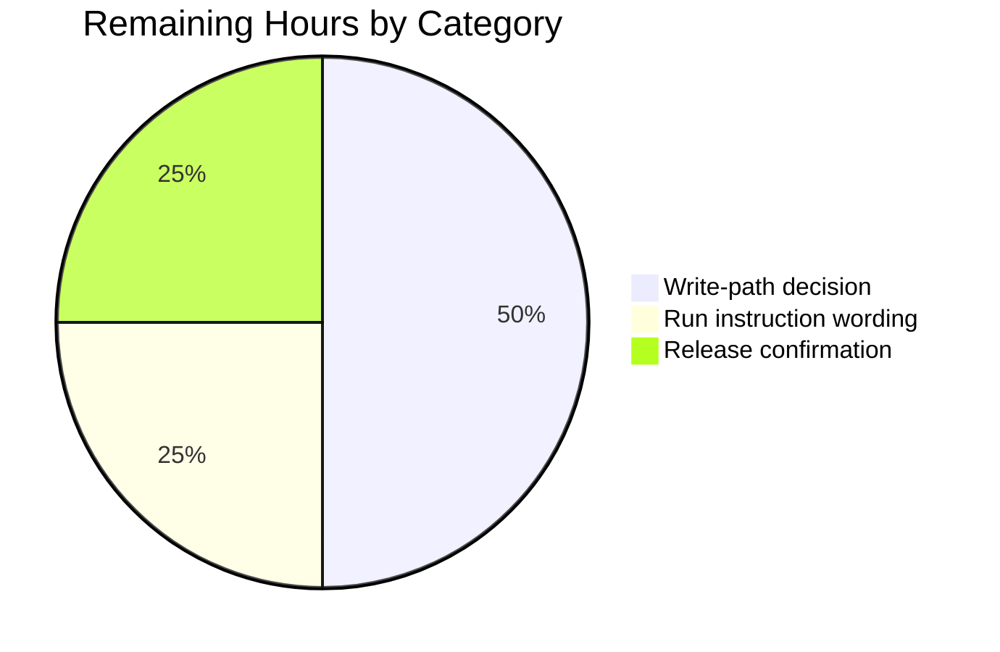

# 1. Executive Summary

## 1.1 Project Overview

A single-file command-line program that writes `Welcome to Blitzy` to standard output, unformatted, in the fewest lines the language allows, with one instructions file carrying the install and run facts. Its audience is a developer or reviewer who wants the greeting from one command. The impact is deliberately minimal — a smallest-diff proof of concept, not production system software: no configuration, no operational surface, no interface to version. It is two files at the repository root: `welcome.js`, two lines of JavaScript the Node.js runtime executes directly, and `README.md`, three lines naming the runtime to install and the command to run.

## 1.2 Completion Status



| Metric | Hours |
|--------|-------|
| Total Hours | 12 |
| Completed Hours (AI + Manual) | 10 |
| Remaining Hours | 2 |

Completion is 83% — 10 of 12 hours. Completed hours are work delivered and verified; the remaining 2 are caveat closure, not unimplemented functionality.

## 1.3 Key Accomplishments

- Prints exactly `Welcome to Blitzy`, byte-verified (18 bytes with the terminator), unformatted (`welcome.js:2`).
- One command runs it from the repository root: `node welcome.js`, with nothing to install (`README.md:3`).
- Indifferent to environment: stripped environment, either locale, isolated copy, absolute path.
- Exits on its own with status 0, writes nothing to standard error, reads no input.
- Instructions carry the install and run facts in three lines, within the five-line bound.
- Standard library only: no manifest, lockfile, dependency or version pin.
- Exactly two files changed against the initial commit — one added, one updated.
- The project's gate and byte-level checks all pass (52 of 52).

## 1.4 Critical Unresolved Issues

Four open items, none blocking release. All four scoped requirements are landed; the rest are caveats and standing maintenance items.

| Issue | Impact | Owner | ETA |
|-------|--------|-------|-----|
| The run instruction does not name the working directory (`README.md:3`) | A reader running the relative command from elsewhere gets `MODULE_NOT_FOUND` (exit 1) instead of the greeting; from the repository root it is exact | Project owner | With the next documentation change |
| The release line the install fact points to was never exercised | Behaviour on a release other than the 22.x LTS line rests on the portability of one standard-library call, not on a run | Whoever cuts the release | At the next gate run |
| Unwritable standard output is silent (`welcome.js:2`) | Closed output, a full device or an early-closing reader leave exit 0 with nothing written, so a pipeline cannot distinguish a written line from a dropped one by exit status | Project owner | With the next behaviour change |
| No automated regression net exists | A future edit to the literal, the filename or the instructions file is caught only by a manual pass, since no test artefact or pipeline is part of the delivery | Project owner | If the project outgrows prototype scope |

## 1.5 Access Issues

No access issues identified: no credentials, secrets or third-party API access are required, and every resource needed was reachable.

## 1.6 Recommended Next Steps

1. [Medium] Decide the run instruction's wording so the working directory is unambiguous.
2. [Medium] Run the project's gate once on the runtime release the instructions point to.
3. [Low] Decide the silent-write caveat: accept it, or add a write check if the constraint is relaxed.
4. [Low] If the project outgrows prototype scope, add one assertion for the printed line plus a gate.
5. [Low] Keep the instructions file aligned with the install facts.

# 2. Project Hours Breakdown

## 2.1 Completed Work Detail

| Component | Hours | Description |
|-----------|-------|-------------|
| Program — `welcome.js` (exact output, one-line comment) | 2 | The two-line program: the single-line JSDoc summary and the one statement that writes the greeting to standard output, authored to the byte-exact required content, standard library only, with no dependency, module syntax or manifest. |
| Instructions file — `README.md` (install and run facts) | 2 | The install fact and the run command in three lines within the five-line bound, replacing the placeholder content and naming the file that exists at the repository root. |
| Runtime verification of the documented command | 3 | Executing the deliverable across invocation shapes: byte-exact output, stream separation and exit status, pipe/redirect/terminal output, the argument surface, working-directory and isolated-copy portability, environment and locale independence, self-termination with input closed, repeatability, and the no-network and no-side-effect checks. |
| Static verification of content, scope and mandated absences | 3 | Byte-exact comparison of both files against the required content, the two-file scope against the initial commit, the sanctioned-absence enumeration (no manifest, lockfile, dependency, test artefact, build or pipeline configuration, error handler, logging, environment configuration or hardening), the comment and tag inventory, and the placeholder and secret sweeps. |
| **Total** | **10** | |

## 2.2 Remaining Work Detail

| Category | Hours | Priority |
|----------|-------|----------|
| Run instruction wording — name the working directory, or record the decision to rely on the file's location beside the program | 0.5 | Medium |
| Runtime release confirmation — run the documented gate once on the release line the install fact points to | 0.5 | Medium |
| Write-path caveat decision — accept the silent-write behaviour as documented, or relax the no-hardening constraint and add a write check with its verification | 1 | Low |
| **Total** | **2** | |

Each category traces to a scoped requirement or a recorded departure: the wording item to the single-command run requirement (`README.md:3`), the release confirmation to the documented install fact, and the write-path decision to the exact-output statement (`welcome.js:2`).

## 2.3 Hours Reconciliation and Completion Calculation

- Completed 10h (Section 2.1) + Remaining 2h (Section 2.2) = **12h total project hours** (Section 1.2).
- Completion = Completed ÷ Total = 10 ÷ 12 = 83.3%, stated as **83%** (Section 1.2, Section 8).
- Section 2.1 sums to the Completed Hours in Section 1.2; Section 2.2 sums to the Remaining Hours in Section 1.2 and to the "Remaining Work" value in Section 7.
- Every hour above traces to a scoped requirement — the exact output and the one-line comment, the single-command run, the instructions file within its line bound — or to the mandated absences that define the delivery's shape. No hour is estimated for work outside the delivered two-file scope.
- Completed hours reflect work delivered and verified: authoring to byte-exact content, executing the documented command across its invocation shapes, and verifying content, scope and absences. Remaining hours are caveat closure and verification coverage, not unimplemented functionality; every scoped requirement is landed.

# 3. Test Results

Every count below was produced by executing the check in this repository on the delivered revision; the gate and the byte-level runs are the project's whole verification surface, since no test artefact is part of the delivery.

| Area / Category | Framework | Tests | Passed | Failed | Coverage | What This Proves |
|-----------------|-----------|-------|--------|--------|----------|------------------|
| Static parse of the program | `node --check` | 1 | 1 | 0 | Not tracked — no coverage tooling exists in this project | The file parses cleanly as a plain script with no module syntax, so the runtime needs no manifest or configuration to read it |
| Byte-exact output | shell with `node`, `od`, `cmp`, `wc` | 13 | 13 | 0 | Not tracked | Standard output is exactly the 17-character message plus one line terminator — no escape, quote, padding, JSON wrapper, second line or standard-error output |
| Invocation shapes | shell with `node`, `timeout`, `script` | 11 | 11 | 0 | Not tracked | The documented command runs as written: no flag or argument changes it, it never reads input, it terminates on its own, and a terminal, a pipe, a redirect and an isolated copy all yield identical bytes |
| Environment and locale independence | shell with `env` | 5 | 5 | 0 | Not tracked | The run needs no environment variable, no `PATH` entry and no particular locale, so it is portable on any host with the runtime |
| Documented reader flow | shell extraction of the backticked command | 10 | 10 | 0 | Not tracked | The install fact names the runtime that is present and the command as documented prints the promised line end to end |
| Scope and integrity | `git`, shell | 9 | 9 | 0 | Not tracked | The change is confined to the two agreed files, with no manifest, lockfile, test artefact, placeholder, leftover stub or input surface |
| Unwritable standard output | shell with `node` | 3 | 3 | 0 | Not tracked | Closed output, a full device and an early-closing reader all leave exit 0 with empty standard error and nothing written — the documented no-error-path behaviour |
| **Total** | | **52** | **52** | **0** | | |

**Not covered.** The comment's form is asserted by reading `welcome.js`, not by any executing test, so a human should confirm after any edit that the single-line summary remains the file's only comment; nothing automated guards it. The instructions file was validated by line and byte rather than by a Markdown parser, since none is installed and adding one is outside the delivery's constraints, so a rendering quirk would not have been caught here. The release line the install fact points to was never exercised — every run used the 22.x LTS runtime present on the machine. No browser-rendered surface exists in this deliverable, so no page, screen or interactive flow could be exercised at all; a UI test would have nothing to attach to. Finally, the project ships no test suite by design: there is no test command to run, so nothing above is repeatable at commit time without invoking the gate and the byte-level checks manually.

# 4. Runtime Validation & UI Verification

The deliverable is a command-line program with no web, database, queue or external-service surface, so every runtime check below was driven from the terminal against the real program.

- ✅ **Startup and the documented run** — `node welcome.js` from the repository root prints `Welcome to Blitzy` and exits 0, with no setup, flag or prefix.
- ✅ **Byte-exact output** — standard output is 18 bytes: the 17-character message plus one line terminator, confirmed by hex dump and byte comparison, with no escape, quote, padding or wrapper bytes.
- ✅ **Streams and exit status** — exit status 0 and empty standard error in every shape exercised; no diagnostic, warning or second line anywhere.
- ✅ **Input and argument indifference** — no argument, option or piped input alters the output; closed input and never-ending input both return promptly rather than blocking.
- ✅ **Output channels and placement** — a pseudo-terminal, a pipe, a file redirect, an isolated single-file copy and an absolute path from another directory all produce identical bytes.
- ✅ **Environment and locale** — identical bytes under a stripped environment, with no `PATH` at all, and under either locale setting.
- ✅ **Repeatability and cleanliness** — three consecutive runs are byte-identical, and nothing is written to disk, hashed, or changed in the repository; no network access is required.
- ✅ **Documented reader flow end to end** — the install fact names the runtime actually present, and the command extracted from the instructions file prints the promised line.
- ⚠ **Working directory** — the documented relative form run from another directory exits 1 with a module-not-found error; the command is exact from the repository root, which is the context the instructions assume.
- ⚠ **Unwritable standard output** — closed output, a full device and an early-closing reader all leave exit 0 with nothing written and nothing on standard error.

No ❌ line appears: nothing that was driven failed, and no flow, endpoint or integration was observed to be broken. Three surfaces were never exercised at runtime and cannot be, because they do not exist in this deliverable — there is no browser-rendered page, screen or interactive flow to drive, no database, queue or external service to integrate against, and no endpoint or port to call. The release line the install fact points to was likewise never run: every observation above comes from the 22.x LTS runtime installed on the machine.

# 5. Compliance & Quality Review

## 5.1 Compliance Matrix

| Deliverable | Benchmark | Status | Evidence |
|-------------|-----------|--------|----------|
| Program output (`welcome.js:2`) | Exact required output, unformatted | ✅ PASS | 18 bytes, hex-verified, no formatting bytes, one line only |
| Comment form (`welcome.js:1`) | Single-line summary, no JSDoc tags | ✅ PASS | One comment line, one JSDoc block, zero tag hits |
| One-command usability (`README.md:3`) | Runs as documented with no other step | ✅ PASS | Documented command executed verbatim from the repository root |
| Instructions file (`README.md:1-3`) | Install and run facts within the line bound | ✅ PASS | Three lines, one heading, no forbidden section, table of contents or badge |
| Acceptance content (both files) | Byte-exact to the required content | ✅ PASS | Byte comparison of each file against its required content passes |
| Scope discipline | Only the agreed paths change | ✅ PASS | One file added, one updated, no deletion, no third path, clean working tree |
| Dependency posture | Standard library only | ✅ PASS | One `console` call, zero imports, no manifest, no lockfile, no version pin |
| Build posture | No build, transpile or bundle step | ✅ PASS | The runtime executes the file directly; no build configuration exists |
| Mandated absences | No test artefact, pipeline, container, handler, logging or hardening | ✅ PASS | Every named artefact class verified absent, as the delivery requires |
| Security baseline | No reachable surface to protect | ✅ PASS | No input, secret, injection sink, socket, persistence or dependency to audit |
| Code hygiene | No placeholder, stub or dead code | ✅ PASS | Zero placeholder and secret hits; two lines, both executed |
| Documentation accuracy | Every documented claim holds | ✅ PASS | Run target exists under the documented name; the install page resolved live |

## 5.2 AAP & Rule Divergences and Gaps

| # | What the AAP/Rule Required | What Was Delivered Instead | Why It Diverged | Impact | Remediation |
|---|----------------------------|----------------------------|-----------------|--------|-------------|
| D1 | The download page's LTS release, v24.22.1 "Krypton", as the runtime a reader installs | Instructions name "Node.js LTS" with no version; the build and every run used the 22.x LTS line (`README.md:3`) | The sanctioned runtime lines for this work are 20.x and 22.x and Node 24 is not one of them — a restriction that outranks the plan's documentation-level recommendation — and the plan forbids a version pin | None on behaviour; the named release has never been exercised | Run the documented gate once on the release line you intend to document (0.5h) |
| D2 | `README.md` created as a new file | An in-place update of the already-tracked two-line placeholder, both lines replaced in one change (`README.md:1-3`) | The file already existed and was tracked; disk is authoritative on existence, and no second file, rename or move was made | None — the delivered text equals the required three lines byte for byte | None required |
| D3 | Run command fixed as `node welcome.js` from the repository root, with the instructions file's three lines fixed verbatim under a five-line bound | The line says "then run `node welcome.js`" and names no directory (`README.md:3`) | The fixed content left no room for the directory, and the command is exact where the plan places it | A reader running the relative form elsewhere sees a module-not-found error instead of the greeting | Decide the wording and add the directory, or record the decision to rely on the file's own location (0.5h) |
| D4 | Install link to the download page (`https://nodejs.org/en/download`) | The bare host `https://nodejs.org`, exactly as the fixed content specifies (`README.md:3`) | The fixed content, which governs the file's text, carries the bare host | One extra navigation step to the same official source | None required; if revised, change plan and file together |
| D5 | A committed test artefact and a read-only lint pass | Neither exists; verification was the project's gate plus byte-level runs, kept outside the repository's tracked content | The request's own constraint forbids test files, suites, lockfiles and dependencies, and no linter, manifest or module tree exists to run one against — sanctioned by the request | Nothing shipped is unverified, but no automated net protects a future edit | None required for this delivery; adding a gate is a new decision if the project outgrows prototype scope (≈2h) |
| D6 | A decision comment beside the code, as general practice expects | `welcome.js` carries only its single-line JSDoc summary (`welcome.js:1-2`) | The plan fixes those two lines verbatim as the acceptance criterion and permits no comment beyond the summary — sanctioned by the request's constraints | The runtime rationale lives in the project record rather than beside the code; harmless at two lines | None required |

**D1 — runtime release.** The plan names the download page's LTS release, v24.22.1 "Krypton", as the runtime a reader installs, while the delivered instructions say only "Node.js LTS" (`README.md:3`). The build and every run used the 22.x LTS line present on the machine, because the sanctioned runtime lines are 20.x from 20.20.2 and 22.x from 22.12.0 — Node 24 is not one — while the plan forbids pinning a version, an `engines` field or a compatibility note. The wording stays accurate under either line and the output is identical, but the release the plan names was never exercised. Run the documented gate once on the release you intend to document.

**D2 — instructions file operation.** The plan lists `README.md` among the files created new. What shipped is an in-place update: the repository already tracked a two-line placeholder README, and the delivered revision replaces both of its lines in a single change, leaving three lines of install and run facts and no second file, rename or move (`README.md:1-3`). Disk is authoritative on whether a file exists, so the operation label did not match what was possible. Nothing about the content differs: the delivered file equals the required three lines byte for byte, so completeness and the documentation's accuracy are unaffected. No action is required.

**D3 — working directory.** The plan fixes the run command as `node welcome.js` invoked from the repository root, and fixes the instructions file's three lines verbatim inside a five-line bound. The delivered line says "then run `node welcome.js`" and never names the directory (`README.md:3`). Followed literally from anywhere else, the relative path resolves against the wrong directory, so the reader sees a module-not-found error and exit status 1 instead of the greeting; from the repository root the command is exact and prints the line. Because the wording was the plan's own fixed content, closing this means changing that text — a decision for the owner, about half an hour.

**D4 — install link depth.** The plan's prose sends the reader to the download page (`https://nodejs.org/en/download`) while the instructions file carries the bare host (`https://nodejs.org`, `README.md:3`). The file's text is the plan's own fixed acceptance content, and that content names the bare host, so the file matches the higher source exactly and needs no change. The host resolves as expected — a live request returned a redirect to the official site — so a reader takes one extra navigation step to the same official source. Nothing is broken and no action is required; if the link is ever revised, revise the plan's prose and the file together so the two do not drift apart.

**D5 — no test artefact and no lint pass.** The validation practice normally applied to a change of this kind expects a committed test artefact and a read-only lint pass. The delivery contains neither, and neither could exist here: the request forbids test files, suites, lockfiles and dependencies, and the repository holds no linter, manifest or module tree to run one against — installing any of them would breach that same constraint. Verification was therefore the project's own gate, `node --check welcome.js && [ "$(node welcome.js)" = "Welcome to Blitzy" ]`, plus the byte-level runs and checks. Nothing shipped is unverified, but no automated net protects a future edit; adding one is a new decision rather than outstanding work.

**D6 — no decision comment in the code.** The general practice of recording a design decision beside the code it affects yields here to the file's fixed content: `welcome.js` carries only its single-line JSDoc summary, so the rationale for running on the 22.x LTS line lives in the project's planning and change record rather than in the file (`welcome.js:1-2`). The plan fixes those two lines verbatim as the acceptance criterion and permits no comment beyond the summary, so a decision comment could not be added without breaking the required content — and at two lines there is no ambiguity for a reader to resolve. No action is required; if the program ever grows, revisit where such rationale belongs.

# 6. Risk Assessment

| Risk | Category | Severity | Probability | Mitigation | Status |
|------|----------|----------|-------------|------------|--------|
| No automated regression net: no test artefact, linter or pipeline is part of the delivery, so an edit to the printed literal, the filename or the instructions file is caught only by a manual pass | Technical | Medium | High | Run the documented gate `node --check welcome.js && [ "$(node welcome.js)" = "Welcome to Blitzy" ]` before and after every change, and add a single assertion plus a gate if the project outgrows its proof-of-concept scope | Open, accepted by design |
| Run instruction does not name the working directory, so the documented relative form run from elsewhere fails with a module-not-found error (measured: exit 1) | Operational | Low | Medium | Run the command from the repository root where the program and its instructions sit, or add the directory to the instruction | Open |
| Runtime coverage is limited to one LTS line and no version is pinned, so a reader on another supported release relies on the portability of one standard-library call | Technical | Low | Low | Run the documented gate once on the release line the install fact points to | Open |
| A dropped write is invisible: closed output, a full device and an early-closing reader all leave exit 0 with nothing written, so a pipeline cannot tell a written line from a lost one by exit status | Operational | Low | Medium | Assert the output bytes rather than the exit status in any consuming script; add a write check only as a new decision, since the delivery's constraints exclude hardening | Open, accepted by design |
| Scope drift: any future import, extra comment line, third statement, manifest or additional file would break the constraints this delivery is built on | Technical | Medium | Low | Treat the byte-exact content of both files and the two-file scope as the review checklist for any change | Open |
| The documented install link points at the host root rather than the download page, so a reader navigates one extra step | Operational | Low | Low | None needed; if the link is revised, change the documented fact and the text together | Accepted |

No security, dependency or integration risks were identified. The program accepts no input, holds no secret, opens no socket, persists nothing, has no dependency tree to audit and emits only a fixed public greeting, so those risk classes are absent by construction rather than mitigated. No monitoring risk is carried either: the whole program is one unconditional write with no failure mode to observe, and the absence of logging is a deliberate part of its scope.

# 7. Visual Project Status



The completed share is shown in Blitzy dark blue (#5B39F3) and the remaining share in white (#FFFFFF); the remaining 2 hours are the caveat closure and release confirmation listed in Section 2.2, and they equal the Remaining Hours in Section 1.2.



Priority distribution of that remaining work is two Medium items and one Low item; nothing outstanding is High priority, because every scoped requirement is already delivered and verified (Section 2.2).

# 8. Summary & Recommendations

The project delivered exactly what it set out to: a two-file, dependency-free command-line program that prints `Welcome to Blitzy` unformatted on standard output, plus the instructions that let a reader install a runtime and run one command to see it. Both files match their required content byte for byte — a two-line program and a three-line instructions file — and the change is confined to those two paths against the initial revision, one file added and one updated, with no unrelated editing anywhere in the tree.

What was verified is broader than the two lines of code that carry the behaviour. The documented command was executed across its invocation shapes: a pseudo-terminal, a pipe and a redirect all yield identical bytes; no argument, option or piped input changes the output; the program never reads input and always terminates on its own with status 0 and empty standard error; it runs from an isolated single-file copy, from any directory by absolute path, under a stripped environment, with no `PATH`, and under either locale setting. The whole verification surface — the project's gate plus the byte-level checks — passed 52 of 52 checks, so the greeting, the filename and the run command the instructions promise are all confirmed rather than assumed.

Four open items remain, none of them unfinished functionality: three are caveats on delivered behaviour and one is a standing gap. The instructions fix the run command without naming the working directory, so a reader who runs it from elsewhere sees a module-not-found error while it is exact from the repository root. Every run used the 22.x LTS runtime present on the machine, so the release line the install fact points to has not been exercised. And a dropped write is invisible: with output closed or unwritable the process still exits 0 having written nothing, so a pipeline must check bytes rather than exit status. The fourth is the absence of any automated net, since no test artefact or pipeline is part of the delivery.

Completion stands at 83% — 10 of 12 hours — and that figure measures remaining effort rather than missing behaviour. All four scoped requirements are landed and verified: the exact unformatted output, the single-line comment as the file's only comment, the one-command run with nothing else needed, and the install and run instructions within their line bound. The two remaining hours are the caveat closure and release confirmation described above, plus the decision on the write-path behaviour. Everything else the delivery constraints exclude — tests, manifests, pipelines, containers, handlers, logging and configuration — is excluded deliberately, and their absence is not a gap to be filled.

The project is ready for delivery in the terms it was specified: a smallest-diff proof of concept, complete when it prints the string. It should not be read as production system software, and production hardening should not be inferred from it — the program accepts no input, holds no secret, opens no socket and persists nothing, so there is no operational surface to harden and no security control it needs. Before adopting it beyond that scope, close the three behaviour caveats, run the documented gate on the release line you intend to document, and decide whether to add the automated check that would protect the greeting from a future edit.

# 9. Development Guide

### System prerequisites

- A Node.js runtime on a supported line: **20.x from 20.20.2**, or **22.x from 22.12.0**. Node 24 is not a supported line here.
- Git, only if you intend to inspect history or commit changes.
- Nothing else — no compiler, package manager step, database, service, environment variable, secret or configuration.

Confirm the runtime before anything else:

```bash
node -v          # a supported line, e.g. v22.23.3
node -p "process.release.lts"   # e.g. Jod, confirming an LTS line
```

### Environment setup

None is required: there is no virtual environment, no `.env` file and no configuration to load. Work from the repository root — the directory that holds `welcome.js` and `README.md`:

```bash
cd <repository root>
```

### Dependency installation

There are none to install. **Do not run `npm install`**: the repository has no manifest, lockfile or module tree, and the project's constraints forbid adding one. The program uses only the runtime's built-in `console`.

```bash
ls package.json package-lock.json 2>&1   # both print "No such file or directory" — by design
```

### Build

There is no build, transpile or bundle step. The runtime executes the file directly.

### Application startup

```bash
node welcome.js
```

Expected output, and nothing else:

```
Welcome to Blitzy
```

The process writes the line, exits on its own with status 0 and leaves the working tree untouched.

### Verification steps

```bash
node --check welcome.js                                                   # parses; no output, exit 0
node --check welcome.js && [ "$(node welcome.js)" = "Welcome to Blitzy" ] # project gate; no output, exit 0
node welcome.js | od -c                                                   # 18 bytes ending in \n
node welcome.js > out.txt 2> err.txt; echo "exit=$?"                      # exit=0; err.txt is empty; out.txt is 18 bytes
cmp out.txt <(printf 'Welcome to Blitzy\n') && echo "byte-exact"          # byte-exact
```

The first two commands print nothing when they pass; the exit status is the signal, so check it with `echo $?` if you are scripting them.

### Example usage

```bash
cd <repository root>
node welcome.js            # Welcome to Blitzy

node welcome.js | wc -c    # 18 — the 17-character message plus one line terminator
node welcome.js > greeting.txt   # capture the line; the file is 18 bytes

# from any other directory, name the file by absolute path
node <repository root>/welcome.js
```

### Troubleshooting

| Symptom | Cause | Resolution |
|---------|-------|------------|
| `node: command not found` | No runtime on `PATH` | Install a supported Node.js release from https://nodejs.org |
| A module-not-found error with exit status 1 | The relative command was run from another directory | Run it from the repository root, or pass the absolute path to `welcome.js` |
| The command exits 0 but nothing appears | Standard output was closed or unwritable (a closed descriptor, a full device, a reader that closed early) | Verify the bytes (`node welcome.js \| od -c`) rather than the exit status; nothing is written and no error is emitted, by design |
| `npm test` or `npm run …` complains about a missing manifest | No manifest exists, by design | There is no test or build command; verify with the gate above |
| An edit to the greeting or the filename goes unnoticed | No test suite, linter or pipeline is part of the delivery | Run the gate after every change; adding an automated check is a decision to revisit the constraints |
| The output is not the expected line | The written literal was edited | Restore the two required lines — see the key file locations in the appendices |

# 10. Appendices

### A. Command Reference

| Purpose | Command (from the repository root) | Expected result |
|---------|------------------------------------|-----------------|
| Run the program | `node welcome.js` | Prints `Welcome to Blitzy`; exit 0; nothing on standard error |
| Parse check | `node --check welcome.js` | No output; exit 0 |
| Project gate | `node --check welcome.js && [ "$(node welcome.js)" = "Welcome to Blitzy" ]` | No output; exit 0 |
| Confirm the runtime | `node -v` | A supported line, e.g. `v22.23.3` |
| Inspect the output bytes | `node welcome.js \| od -c` | 18 bytes: `W e l c o m e   t o   B l i t z y  \n` |
| Prove the output byte for byte | `node welcome.js > out.txt; cmp out.txt <(printf 'Welcome to Blitzy\n')` | No output from `cmp`; files identical |
| Confirm nothing else is written | `node welcome.js > out.txt 2> err.txt; echo "exit=$?"; wc -c err.txt` | `exit=0`; `0 err.txt` |
| Run from another directory | `node <repository root>/welcome.js` | Same line; exit 0 |
| Inspect the delivered change | `git diff <initial commit>..HEAD --stat` | Two files changed: `welcome.js` added, `README.md` updated |

### B. Port Reference

The deliverable opens no port and runs no service: it writes one line to standard output and exits.

| Port / Service | Used | Notes |
|----------------|------|-------|
| TCP / UDP | None | No listener, no outbound connection, no socket is opened |
| Database, cache, queue | None | Nothing is persisted, cached or published |
| Web server / HTTP endpoint | None | There is no request/response surface, so nothing to bind |

### C. Key File Locations

| Path | Role | Content |
|------|------|---------|
| `welcome.js` | The program | Two lines: `/** Prints "Welcome to Blitzy". */` and `console.log("Welcome to Blitzy");` |
| `README.md` | Install and run instructions | Three lines: the title, a blank line, and the sentence naming the runtime to install and the command to run |

### D. Technology Versions

| Component | Version | Notes |
|-----------|---------|-------|
| Node.js runtime | Supported lines: 20.x from 20.20.2, 22.x from 22.12.0 | Verified on `v22.23.3` (LTS "Jod"); Node 24 is not a supported line and no version is pinned in the repository |
| Language | JavaScript (plain script, no module syntax) | No transpiler, no bundler, no `"type"` field — the runtime executes the file directly |
| Dependencies | None | Standard library only; no manifest, lockfile or module tree exists |
| Git | Any current release | Only needed to inspect or commit changes; the delivered change is two paths against the initial revision |

### E. Environment Variable Reference

No environment variable is read, required or set. The program resolves nothing from the environment, and the verification runs proved identical output under a stripped environment (`env -i PATH="$PATH"`), with no `PATH` at all, and with `HOME`, `TERM` and `LANG` unset.

| Variable | Required | Purpose |
|----------|----------|---------|
| — | None | No configuration surface exists; nothing is read from the environment |

### F. Developer Tools Guide

| Tool | Why you need it | Notes |
|------|-----------------|-------|
| `node` | Runs the program and the parse check | The only runtime dependency of the deliverable |
| `git` | Inspects the change and the two-file scope | `git diff <initial commit>..HEAD --name-status` shows `A welcome.js` and `M README.md` |
| `od`, `cmp`, `wc`, `printf` | Byte-level verification of the output | Used for the checks in Section 3; all part of a standard shell environment |
| `script` (util-linux) | Confirms output on a real terminal | Optional; shows the line prints with no escape codes on a pseudo-terminal |
| No linter, formatter, type checker or test runner | — | None is configured and none may be added under the delivery's constraints; `node --check` is the available static check |
